<!-- ═══════════════════════════════════════════════════════════════
     CERRADO//OS — perfil de ryamsoares-s
     paleta: noite #0E1411 · sol #E8A33D · terra #C2502E · cerrado #9DBF88 · palha #F2E8D5
     ═══════════════════════════════════════════════════════════════ -->

<p align="center">
  
</p>

<p align="center">
  <a href="https://github.com/ryamsoares-s">
    
  </a>
</p>

<p align="center">
  
  
  
</p>

<p align="center"></p>

## `01 // ORIGEM`
<sub>quem roda neste sistema</sub>

```typescript
const ryam = {
  base:       "Mato Grosso, BR — onde o sol nasce sobre o cerrado",
  formacao:   "Bacharel em Sistemas de Informação",
  papeis:     ["Full-Stack Developer", "Professor no IFMT — Campus Pontes e Lacerda"],
  dominios:   ["energia", "agronegócio", "educação"],
  stack:      ["TypeScript", "NestJS", "React", "Prisma", "PostgreSQL"],
  estudando:  ["otimização com OR-Tools CP-SAT", "infra como código (Terraform)"],
  safraAtual: "IFMT Horários — grade de horários com validação das regras legais",
  mindset:    "Problema real, solução simples, deploy no ar.",
} as const;
```

<p align="center"></p>

## `02 // RAÍZES`
<sub>a stack que sustenta tudo — cada cor é uma camada do solo</sub>

<table>
<tr><td align="right"><b>🌱 Front-end</b></td><td>
  
  
  
  
  
  
  
  
</td></tr>
<tr><td align="right"><b>🪵 Back-end</b></td><td>
  
  
  
  
  
  
  
</td></tr>
<tr><td align="right"><b>🪨 Dados</b></td><td>
  
  
  
</td></tr>
<tr><td align="right"><b>⚡ Cloud · DevOps</b></td><td>
  
  
  
  
  
  
</td></tr>
<tr><td align="right"><b>🧪 Qualidade</b></td><td>
  
  
  
</td></tr>
<tr><td align="right"><b>🧭 Otimização · IoT</b></td><td>
  
  
  
</td></tr>
</table>

<sub>🟠 sol = interface &nbsp;·&nbsp; 🟤 terra = servidor &nbsp;·&nbsp; 🟢 cerrado = dados &nbsp;·&nbsp; ⚪ palha = infra e qualidade</sub>

<p align="center"></p>

## `03 // TERMINAL`
<sub>sequência de boot</sub>

```console
$ cerrado-os --boot --user ryam

[  OK  ] montando /raizes ................. TypeScript · Node.js
[  OK  ] módulo front-end ................. React · Next.js · Vite · Tailwind
[  OK  ] módulo back-end .................. NestJS · Express · tRPC · Prisma
[  OK  ] conectando ao solo ............... PostgreSQL · Redis
[  OK  ] ligando a rede elétrica .......... Docker · GitHub Actions · Vercel
[  OK  ] abrindo a sala de aula ........... Programação Web · Teste de Software
[ WAIT ] solver CP-SAT calibrando ......... grade 2027 a caminho

USER      : ryam@cerrado
ROLE      : Full-Stack Developer · Professor @ IFMT
FIELDS    : energia · agro · educação
BUILDING  : IFMT Horários (kairos-horarios)
STUDYING  : otimização combinatória · infra como código
STATUS    : ONLINE ☀

$ aguardando o próximo desafio... █
```

<p align="center"></p>

## `04 // SAFRA_ATUAL`
<sub>projeto principal</sub>

<table>
<tr>
<td>

### ☀ IFMT Horários &nbsp;<sub><code>kairos-horarios</code></sub>

> *Kairós* (καιρός): para os gregos, **o momento certo**.

Aplicação web para montar a **grade de horários e a carga docente** do IFMT — Campus Pontes e Lacerda
(Ensino Médio Integrado anual e Graduação semestral, nos três turnos). Substitui a planilha
"Horários por Docente".

O coordenador monta e ajusta a grade com **validação instantânea das regras legais**: interjornada de
11 h, até 2 turnos por dia (o 3º só com anuência) e nenhum conflito de docente ou turma. E pode pedir
ao sistema uma **grade inicial viável em minutos**, gerada por um solver de otimização, em vez de dias
de planilha.

<p>
  
  
  
  
  
  
  
  
  
  
</p>

| módulo | o que faz |
|---|---|
| `backend/` | API REST `/api/v1` em NestJS, Prisma + PostgreSQL, filas com Redis/BullMQ |
| `frontend/` | React + Vite + Tailwind + shadcn, TanStack Query e formulários com Zod |
| `packages/rules/` | motor de regras em TypeScript puro, o mesmo no front e no back |
| `solver/` | worker Python com OR-Tools CP-SAT que propõe a grade inicial |

**Status:** 🟡 reta final — preparando a implantação para a grade 2027

<a href="https://github.com/ryamsoares-s/kairos-horarios"></a>


</td>
</tr>
</table>

<p align="center"></p>

## `05 // SALA_DE_AULA`
<sub>o que sai da sala para o GitHub</sub>

| | repositório | o que tem lá |
|:-:|---|---|
| 📚 | [**aula-prog-web**](https://github.com/ryamsoares-s/aula-prog-web) | Programação Web — 4º semestre de Sistemas de Informação (2026/2). Exemplos feitos em sala, atividades, 5 desafios de HTML e CSS e consumo de APIs com `fetch` (ViaCEP e IBGE). |
| 🧪 | **testes-de-software** <sub>🔒</sub> | Teste de Software — 8º semestre. Resolução dos cinco desafios em JavaScript com Jest: 52 testes, 100% de cobertura. |
| 🧩 | [**suap-portarias-extension**](https://github.com/ryamsoares-s/suap-portarias-extension) | Nasceu de um pedido de um colega: extensão Chrome/Edge que baixa em lote as portarias do SUAP/IFMT, usando a sessão já aberta, sem pedir senha e sem mandar dado para fora. |

<p align="center"></p>

## `06 // CAMPO_PROFISSIONAL`
<sub>onde o código vira produto — energia, agro e pesquisa</sub>

| projeto | organização | stack | 🔗 |
|---|---|---|---|
| **enersim-app** | vzacarkim | TypeScript · Node.js | [sime.enersim.com.br](https://sime.enersim.com.br/) |
| **sime-web-frontend** | vzacarkim | TypeScript · React | [sime.enersim.com.br](https://sime.enersim.com.br/) |
| **app-portal-associado** | vzacarkim | TypeScript | [portaldoassociado.enersim.com.br](https://portaldoassociado.enersim.com.br/) |
| **monorepo** | Terra-Commodities | TypeScript · tRPC | [dashboard.terracommodities.agr.br](https://dashboard.terracommodities.agr.br/) |
| **V3D** | leticiafers | TypeScript | [v3d-production.up.railway.app](https://v3d-production.up.railway.app/) |
| **Sentinela IA** | SENTINELA-IA-IFMT | TypeScript | 🔒 vigilância geoespacial contra o garimpo ilegal |
| **IF Alerta Queimadas** | IF-Alerta-Queimadas | TypeScript | 🔒 privado |

<p align="center"></p>

## `07 // ARQUIVO_DE_SAFRAS`
<sub>projetos de estudo e de outras estações — a evolução até aqui</sub>

<details>
<summary><b>abrir o arquivo</b> &nbsp;<sub>(12 projetos)</sub></summary>
<br/>

| safra | projeto | o que foi | stack |
|:-:|---|---|---|
| `2026` | **imovel-ir** <sub>🔒</sub> · [demo](https://imovel-ir-eosin.vercel.app) | controle de pagamentos de imóvel financiado para a declaração do IRPF | NestJS · React · Prisma |
| `2025` | [rymei](https://github.com/ryamsoares-s/rymei) · [demo](https://rymei-playryam-gmailcoms-projects.vercel.app) | controle financeiro para microempreendedores individuais | TypeScript |
| `2025` | [bella-prata-website](https://github.com/ryamsoares-s/bella-prata-website) · [demo](https://bella-prata-website.vercel.app) | SPA para uma loja de pratas | Next.js |
| `2025` | [cria-bola-de-cristal](https://github.com/ryamsoares-s/cria-bola-de-cristal) | experimento com Next.js | Next.js |
| `2025` | [express-auth-boilerplate](https://github.com/ryamsoares-s/express-auth-boilerplate) | primeira API: rotas, middlewares, JWT e Prisma | Express · Prisma |
| `2025` | [clone-tabnews.com.br](https://github.com/ryamsoares-s/clone-tabnews.com.br) | do zero ao deploy, aprendendo full-stack | Next.js · PostgreSQL · Docker |
| `2025` | [crud-users](https://github.com/ryamsoares-s/crud-users) | atividade de aula sobre testes | TypeScript |
| `2025` | [atividade-tests-uni](https://github.com/ryamsoares-s/atividade-tests-uni) | atividade de aula sobre testes unitários | JavaScript |
| `2025` | [catalogo_moveis](https://github.com/ryamsoares-s/catalogo_moveis) | catálogo de móveis | HTML · CSS |
| `2025` | [Todo-listt-app](https://github.com/ryamsoares-s/Todo-listt-app) | gerenciador de tarefas | JavaScript |
| `2025` | [Logica-code](https://github.com/ryamsoares-s/Logica-code) | primeiros passos em lógica de programação | JavaScript |
| `2025` | [dio-lab-open-source](https://github.com/ryamsoares-s/dio-lab-open-source) | primeira contribuição open source (DIO) | Git · GitHub |

</details>

<p align="center"></p>

## `08 // TELEMETRIA`
<sub>leituras do medidor — atualizadas pelos serviços, sem número inventado</sub>

<p align="center">
  
  
</p>

<p align="center">
  
</p>

<p align="center">
  
</p>

<p align="center"></p>

## `09 // MATRIZ_DE_PLANTIO`
<sub>cada quadrado é um dia de contribuição; a cobra faz a colheita</sub>

<p align="center">
  
</p>

<p align="center"></p>

## `10 // SINAL`
<sub>abra um canal</sub>

<p align="center">
  <a href="https://www.linkedin.com/in/ryam-s-da-silva-594220252/"></a>
  <a href="https://www.instagram.com/rsoarees_400"></a>
  <a href="https://github.com/ryamsoares-s"></a>
</p>

<p align="center">
  
</p>

<p align="center"><sub><code>$ shutdown --after-deploy</code> &nbsp;·&nbsp; do cerrado pro deploy ☀</sub></p>
