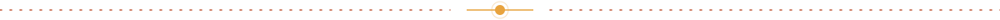

  

  

  
  
  

## ❯ Sobre mim

Quem sou e onde atuo.

Sou desenvolvedor full-stack: construo sistemas web completos, da tela que a pessoa usa até o servidor e o
banco de dados que guardam as informações. Trabalho na [**TerraWatt Tecnologia**](https://terrawatt.com.br/),
que cria o ecossistema de software para a Geração Distribuída Compartilhada de energia.
Também desenvolvo software para o **agronegócio** e sou professor no **IFMT — Campus Pontes e Lacerda**, onde ensino programação.

<table>
<tr><td><b>Formação</b></td><td>Bacharel em Sistemas de Informação</td></tr>
<tr><td><b>Empresa</b></td><td><a href="https://terrawatt.com.br/">TerraWatt Tecnologia</a>, software para Geração Distribuída Compartilhada de energia</td></tr>
<tr><td><b>Atuação</b></td><td>Desenvolvedor Full-Stack na TerraWatt e professor no IFMT</td></tr>
<tr><td><b>Setores</b></td><td>Energia, agronegócio e educação</td></tr>
<tr><td><b>Projeto atual</b></td><td>IFMT Horários, sistema de grade de horários escolares</td></tr>
<tr><td><b>Estudando</b></td><td>Otimização de problemas de agenda e infraestrutura em nuvem</td></tr>
<tr><td><b>ORCID</b></td><td><a href="https://orcid.org/0009-0007-7356-3356">0009-0007-7356-3356</a></td></tr>
</table>

## ❯ O que eu faço

Os tipos de trabalho que entrego, com exemplos reais.

| | Serviço | Exemplo |
|:-:|---|---|
| 🖥️ | **Sistemas web sob medida**: telas, servidor e banco de dados, do início ao deploy | [Imóvel IR](https://imovel-ir-eosin.vercel.app/), controle de financiamento de imóvel para o Imposto de Renda |
| ⚙️ | **Automação de processos**: troco planilhas e tarefas repetitivas por sistemas | IFMT Horários, que substitui a planilha de horários do campus, e o Energy Reader, que lê faturas de energia sem digitação |
| 📊 | **Painéis e portais para empresas**: acompanhamento de dados e atendimento a clientes | SIME e Portal do Associado, da TerraWatt, e o painel da Terra Commodities |
| 🎓 | **Ensino de programação**: aulas, exercícios e projetos com as turmas | disciplina de Programação Web no IFMT |

## ❯ Tecnologias

Ferramentas que uso no dia a dia. A cor do ícone indica a parte do sistema.

<table>
<tr><td align="right"><b>Interface</b></td><td>
  
  
  
  
  
  
  
  
</td></tr>
<tr><td align="right"><b>Servidor</b></td><td>
  
  
  
  
  
  
  
</td></tr>
<tr><td align="right"><b>Banco&nbsp;de&nbsp;dados</b></td><td>
  
  
  
</td></tr>
<tr><td align="right"><b>Nuvem&nbsp;e&nbsp;DevOps</b></td><td>
  
  
  
  
  
  
</td></tr>
<tr><td align="right"><b>Testes</b></td><td>
  
  
  
</td></tr>
<tr><td align="right"><b>Otimização&nbsp;e&nbsp;IoT</b></td><td>
  
  
  
</td></tr>
</table>

âmbar: interface &nbsp;·&nbsp; terracota: servidor &nbsp;·&nbsp; verde: banco de dados &nbsp;·&nbsp; creme: nuvem e testes

## ❯ Projeto em destaque

O sistema em que estou trabalhando agora.

<table>
<tr>
<td>

### IFMT Horários

> Sistema web para montar a grade de horários e a carga de aulas dos professores do IFMT — Campus Pontes e Lacerda.

Hoje a grade é feita numa planilha, e conferir as regras à mão leva dias. No sistema, o coordenador monta
a grade e é avisado **na hora** quando algo viola uma regra: descanso mínimo de 11 horas entre jornadas,
limite de turnos por dia, professor ou turma em dois lugares ao mesmo tempo. O sistema também
**sugere uma grade inicial completa em minutos**.

| Parte | O que faz |
|---|---|
| Tela do coordenador | monta e ajusta a grade, com os alertas de regra |
| Servidor | guarda os dados e confere as regras legais |
| Otimizador | calcula uma grade inicial que respeita todas as regras |

  
  
  
  
  
  
  
  
  

</td>
</tr>
</table>

## ❯ Sistemas em produção

Projetos que estão no ar e sendo usados.

| Projeto | Setor | O que é | Acesso |
|---|---|---|---|
| **Imóvel IR** | Finanças pessoais | controle de pagamentos de imóvel financiado para a declaração do IRPF | [abrir ↗](https://imovel-ir-eosin.vercel.app/) |
| **SIME** | Energia · [TerraWatt](https://terrawatt.com.br/) | plataforma de gestão de Geração Distribuída: adesão de clientes, distribuição da energia, faturamento e cobrança | [abrir ↗](https://sime.enersim.com.br/) |
| **Portal do Associado** | Energia · [TerraWatt](https://terrawatt.com.br/) | portal web e app em que o cliente acompanha a economia na conta de luz, baixa faturas e usa o programa de benefícios | [abrir ↗](https://portaldoassociado.enersim.com.br/) |
| **Energy Reader** | Energia · [TerraWatt](https://terrawatt.com.br/) | lê automaticamente as faturas da distribuidora de energia e envia os dados ao SIME, sem digitação | uso interno |
| **Terra Commodities** | Agronegócio | painel de gestão de negócios do produtor rural (boi gordo, grãos e insumos) | [abrir ↗](https://dashboard.terracommodities.agr.br/) |
| **V3D** | Colaboração | aplicação web desenvolvida em equipe | [abrir ↗](https://v3d-production.up.railway.app/) |
| **Sentinela IA** | Pesquisa (IFMT) | vigilância geoespacial com inteligência artificial contra o garimpo ilegal | privado |
| **IF Alerta Queimadas** | Pesquisa (IFMT) | sistema de alerta de queimadas | privado |

## ❯ Ensino

Materiais e ferramentas feitos para as turmas e para o campus.

| Repositório | Conteúdo |
|---|---|
| [**aula-prog-web**](https://github.com/ryamsoares-s/aula-prog-web) | Programação Web, 4º semestre de Sistemas de Informação (2026/2): exemplos de aula, atividades, desafios de HTML e CSS e consumo de dados públicos (CEP e IBGE) |
| **testes-de-software** (privado) | Teste de Software, 8º semestre: resolução dos cinco desafios da disciplina, com 52 testes automatizados |
| [**suap-portarias-extension**](https://github.com/ryamsoares-s/suap-portarias-extension) | extensão para Chrome e Edge que baixa de uma vez as portarias de um servidor no SUAP, sem pedir senha |

## ❯ Estatísticas no GitHub

Geradas automaticamente a partir da minha conta.

  
  

  

  

## ❯ Contribuições

Cada quadrado é um dia do último ano; quanto mais claro, mais contribuições.

  

## ❯ Contato

Fale comigo por qualquer um destes canais.

  
  
  
  

<code>ryamsoares-s:~$ exit</code>

